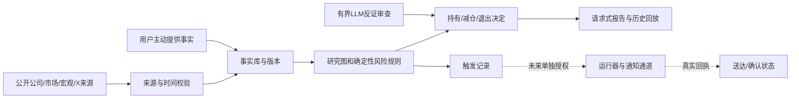

# Serenity 决策与退出流程优化 PRD v1.0

日期：2026-10-20。产品Owner：当前Serenity会话；实施Owner尚未指派。本次交付为研究与方案，未实现新系统、未运行后台监控、未交易。证据截至美国10月19日常规盘，公司披露/X延伸至10月20日北京时间下午。

## 1. 确切结论与第一性原理

**可以优化；现有流程尚不能作为已验证有效的交易策略。应先修复退出、成交后风险复核和提醒闭环，再恢复扩张选股与代理数量。** 不是放弃AI瓶颈和右尾研究，也不是把策略改成跌破一条均线就全部卖掉。

持有本身是今天继续承担风险的决定。其依据应是：从当前价格出发，在明确期限内，可归属于每股的未来兑现，是否值得承担剩余风险、事件跳空和资金机会成本。买入成本解释历史盈亏，不证明今天应该继续持有；公司仍有前景也不充分。

策略目标为“限制不可承受损失，保留能够兑现的右尾”，没有任何规则能同时保证提前卖在顶点、永不踏空和不承受波动。有效改进须把代价一并记录：更早减仓可能减少回吐，也会卖飞；更宽失效位可能保留大牛股，也会扩大亏损。评估必须同时计两边。

**本方案确定的五项取舍：**

1. 以有版本的决定及风险规则为核心；报告、模型和行情抓取围绕它服务。
2. 基本面/估值与持仓风险两条独立判断。经营论点未失效，不得覆盖已触发的风险处置。
3. 成交、建议、触发、提醒、实际执行分别记录，不互相推断。
4. 先做有限、可回放的确定性规则；LLM提供证据解释和反证，不能自由改阈值。
5. 主动提醒是完整产品的必需能力；当前禁止后台任务的边界意味着它尚不能上线，不能把一份文字方案说成已经有人替用户盯盘。

## 2. 问题证据与范围

[全历史审计](../serenity-complete-advice-audit-20261020/REPORT.md)覆盖93线程、507最终答复、1186中间回复；125是主要建议/风险复核消息组，不是交易笔数。原始买入指令未找到的股票保留UNKNOWN，实际成交、费用及资金流不足，不能计算本助手贡献的净收益。

| 故障 | 定位事实 | 要改变的行为 |
|---|---|---|
| 成交后放松预算 | INOD事前建议2改1，成交2后续持；FORM超计划风险只停加仓 | 成交偏离必须同次给出保留/缩减/退出及依据，不能只登记 |
| 用长期故事续接失败交易 | CAMT、INOD经营尚在但风险恶化 | 明确交易模式，风险层不能被公司故事撤销 |
| 盈利保护滞后 | 10月15日才系统补齐11只图 | 盈利时冻结保护规则与卖飞代价，不能下跌后追认早有条件 |
| 新事实造成规则真空 | RXRX/TSM撤旧图，新图迟迟缺席 | 同次临时决定、替代版本期限和责任人 |
| 顺序依赖与假定成交 | POET第一批未执行，后续又按剩余仓表达 | 所有决定按最新确认数量→目标剩余数量 |
| 条件写了但无人持续送达 | TSLA触发后到下一次回顾才明确提醒 | 监测、触发、送达、确认独立验收 |
| 更换估值方法制造买点 | FORM模型切换缺桥接 | 新旧模型以同一股本/期间复算差异 |

[联网证据](RESEARCH_FINDINGS.md)实际核读7个GitHub仓库29份固定commit文件；11家公司披露重点章节，加Sivers生产公告/融资与审计报告；4条X主帖及选定回复；16条日线序列与CBOE VIX、BLS/Fed/Treasury公开信息。并非重做74家全部财报/估值，也不是11家全部报告全文逐字读取。

### 目标与非目标

- 目标：每次持有/减仓/退出可解释、可复算、可过期；首次风险变化得到当期处置；证明提醒是否实际送达；建立可检验的策略效果记录。
- 完整研究范围保留74家正式池、固定九家、历史线索与AI电力/燃机热端链。先维护用户主动提供的现仓事实与风险，再研究新机会。
- 非目标：保证赚钱、择顶择底、自动交易、券商连接、账户读取、建立付费数据/模型订阅、复制整套量化平台或开发新网站。
- 本次验收仅为PRD及公开证据交付；生产实现与投资效果分开验收。

## 3. 用户场景与输出合同

主要使用者是中国时区、整数股、小资金、重视右尾且无法持续盯美股的个人研究使用者。具体资金、可承受回撤和期限只使用用户当轮主动提供的事实，不猜测。研究Owner负责判断，用户负责最终交易决定。

### “今天怎么样”

顺序固定：交易日/时段与数据截点 → QQQ、VIX及相关行业/宏观风险 → 全部最新已确认持仓的持有/减仓/退出决定 → 尚未确认的前次动作与变化 → 新候选及覆盖数量。先回答结论，再列证据。

持仓行必含：代码及公司、用户事实日期、当前证据截点、基本面判断、风险动作、触发是否已满足、目标状态、下一失效/复核、公司事件及未知项。只有证据足够才给HOLD；“没有读完”不能默认持有。

买入结论分开研究门与账户门；未完成不能简化为“不可以买”。用户要求明确判断时先给“可以/不可以”，随后指明是研究完成、研究门通过、停止加仓或退出，避免词义混淆。任何新买入仍须满足现行AGENTS硬门。

### 用户报告成交、未成交或更正

只更新该用户事实的版本；后来的明确更正优先，但不删除旧记录。成交偏离价格/数量或事件前提时，当次重算；缺总资金仅使账户比例UNKNOWN，不能抹去风险已触发或研究候选。用户说“挂单”不能计成交，说“卖了”未给数量则只询问必要缺口，其余研究继续。

### 重要新事实与突发风险

先标识受影响的规则，再给临时动作及依据；旧价格图INVALIDATED不等于可以无限持有。正反消息同时进入：RXRX临床进展与稀释、Sivers生产启动与未点名客户/未披露订单额、AI需求增长与客户融资/自研风险均不能只留一面。

## 4. 策略规则：买入、持有、保护、退出

### 4.1 入场前冻结赚钱机制

每笔研究方案只指定一个主模式：

- **基本面/GARP**：盈利与每股现金兑现为主，期限覆盖明确经营里程碑；估值区间和经济失效优先。
- **趋势参与**：趋势与相对强度构成持有前提，结构失败必须复核/退出；不能未经重审改成长线。
- **事件研究**：仅在用户明确要求时启用；赔率、跳空及事件后处理单列，不能绕过常规24小时重大公司事件门。

主模式之外可以有辅助证据，但不得事后挑选最能支持继续拿的模式。模式变更须新决定ID、当前估值、风险与代价对比，不能回写原规则。

### 4.2 有限门槛，保留参与权

FR-01 **身份与全池**：稳定证券ID+交易所+币种，维护74家正式池、固定九家及历史线索；新上市公司历史不足留缺失。通过/条件观察/排除/未完成四类总数必须相加等于冻结池数。

FR-02 **研究门与账户门分离**：基本面、估值、事件、市场、经济失效分别闭合。只有一个缺口可标条件观察，须Owner/路径/期限；两个以上未闭合标研究未完成。研究门通过、账户未确认时仍输出价格地图和失效，不能说全市场无机会。

FR-03 **现行账户约束**：只使用用户主动提供事实。首股>总资金10%或计划损失>0.5%默认不通过；8%—10%加强审查，≤8%正常。上述是现行治理限制，不是收益已验证参数。无经济依据不能为凑风险预算倒造失效位。

FR-04 **合理参与区**：估值地图含高安全边际、合理参与、昂贵、基本面/事件失效及假设日期；GARP合理参与可首股，不强求深度价值。长期/中国时区优先DAY估值限价研究方案；GTC须到期/复核与坏消息跳空风险。盘中选择须符合现行开盘30分钟及承接/第二次上破规则；不把缺分钟或几美分变硬门。首股当日不再加、不同时并开第二只高相关股。

### 4.3 成交后的预算与持有决定

FR-05 **风险重算**：同时报告原入场计划风险、成交偏离后的入场风险、当前至固定失效的剩余风险。已发生损失是沉没成本；不得只为纠正原错误而不考虑当前价值机械低位卖，也不得隐瞒原违规。价格已越过失效位标TRIGGERED，不能将负距离截为0后宣称风险通过。计算见[数据合同](DATA_CONTRACT.md)。

FR-06 **持有须双层闭合**：基本面/估值层与仓位风险层分别给状态及来源。HOLD只在两层都支持时成立。经营未坏但风险触发可以REDUCE/EXIT；估值回落但经济论点完好不自动退出。UNKNOWN或REUNDERWRITE必须有临时风险决定，不能伪装HOLD。

FR-07 **成交偏离同次处置**：数量、成交价或前提偏离时，须明确保留/减至多少/退出。依赖总资金的预算股数、新建仓/加仓股数在资金未知时不输出；已有用户明确确认的数量，基于已冻结退出规则可表达研究层目标剩余数，范围只能为0至该已知数量，不增加暴露；账户比例仍UNKNOWN。若当前项目对缺总资金时任何股数输出的规定被解释为包含退出，本项是待实施前澄清的治理文义，不能偷偷扩权；至少必须给清空/部分减仓的明确研究动作，不能借此继续默认持有。单股无法拆核心/战术，直接比较留1或退0；不能用“停止加仓”假装缩减已有风险。DPC3股原风险约0.415%，不能因数量偏离自动声称超0.5%。

### 4.4 盈利保护与市场风险

FR-08 **盈利保护在事前形成**：每个可持有方案必须有profit_protection版本，至少列估值兑现/过热后归位、原趋势结构失效、事件前风险以及相关暴露变化中的适用条件、确认时段与动作。没有经济依据时明确未完成并升级复核，不临时编一个统一百分比。保护位须有可定位结构/估值或现金风险依据，不能只因想保住账面利润任意上移。

FR-09 **处置优先序**：

1. 已确认经济论点失败、现金/监管/临床等关键前提失效：EXIT或重新承销决定；不得等待价格反弹才承认。
2. 原定风险/趋势退出条件已满足：按冻结规则给REDUCE/EXIT；如果新事实改变条件，转FR-12，附新旧差异，不能默默撤销。
3. 尚未触发退出但相对强度、行业/市场或估值风险明显恶化：发RISK_REVIEW并要求同次比较继续持有与提前减仓的预期收益/风险；不是单均线自动清仓，也不能仅回“公司没坏”。
4. 无新增反证、未触发条件且估值/风险仍合理：HOLD，记录仍可能承受的回撤与下一检查点。

FR-10 **提前预警和确认退出分开**：价格接近预先冻结的风险位、已披露事件临近、两个不同来源/机制的风险块同步恶化，产生RISK_REVIEW；不得等最终跌破才首次讨论风险。预警接近距离必须随原图记录，来源为价格容差/结构尺度；新的统一距离或回撤百分比只是待验证参数，不能标已有效。动作通过后冻结，不随普通波动漂移。

FR-11 **市场风险层**：每次同时读QQQ与VIX，记录数值/涨跌/结构/时段；SPY/RSP仅宽度代理，能取得真实宽度时另标。SOXX服务半导体/光学，医疗AI主用相关医疗/个股，不能错配。轻微红绿、单VIX点位或单均线不判市场失控；广泛指数结构与广度同步恶化须由可用证据共同支持。市场恶化先限制新增相关风险，并按原规则复核现仓，不自动卖掉一切。

本版**不新增声称有效的统一10%/20%/ATR止盈线**。未来仅对少量预登记保护方案做对比：原经济失效、经济失效+预定结构减仓、经济失效+估值兑现减仓。阈值必须在前瞻观察前冻结，不能用已看过的10月跌幅挑最赚钱值。

### 4.5 规则替换与未执行

FR-12 **新事实替换SLA**：重大财报/融资/临床/重组令旧图过期时，同次交付临时HOLD/REDUCE/EXIT及可用依据。当前请求式模式在首次相关请求中识别已过期规则，完成有限充分补证并尽力同次替换；确实受阻就交付明确缺口/Owner/到期及临时风险决定，并披露上次请求后未监测的时间窗，不能承诺无人发起时自动交付。未来获授权运行模式须在下一常规盘开始前交付新图，盘中发生同样以下一常规盘前为限。到期仍不足，标管线故障、改源/改派并重作临时决定，不继续复制等待。临时HOLD不是无限豁免，须说明短期承担风险优于退出的理由。不得填造价格只求按时交付。

FR-13 **目标剩余数量**：所有分批方案以latest_confirmed_quantity→target_remaining_quantity表达，数量输出适用FR-07当前边界/待澄清条件；即使数量暂不能给，也必须明确最终研究动作和计算式，不能只重复第一步或默认HOLD。建议不计成交；下批动作满足但上批未执行时重算最终目标。已触发信号在反弹后也不得自动消失，须保留触发记录并给当前重新判断；不能机械执行过期动作或假称已卖。

FR-14 **模型桥接**：换DCF/PE/分部法或期限时，以统一股数、币种、当期事实重建旧/新结果；分解增长、利润率、现金转换、资本开支、融资/SBC、税率、终值/倍数贡献。不可解释的模型差异标冲突，不生成新的“可以买”。

## 5. 证据与研究要求

FR-15 **一手公司事件**：SEC最新披露+公司IR新闻/日历，两条有限充分路径，记录截止和范围。未发现未来24小时已知公司重大事件可记通过并保留未披露残余风险；单工具失败改用另一一手路径。宏观事件只披露时间风险，不因一张网页失败否决全市场。

FR-16 **分阶段财务**：成熟成长看现金转换/资本回报；半导体/设备看订单→出货→利润→现金；光子小公司看认证、生产订单、收入与稀释；生物医药看资金、疗效/安全分母和里程碑；电力燃机区分OEM、叶片铸造、合金/涂层/检测及资产运营。净利增30%、ROE15%、三年CAGR不再作为跨阶段统一硬筛，只能在适用模式内使用。

FR-17 **每股兑现与现金质量**：预付款、应付驱动CFO、融资现金、股数/SBC、非GAAP调整、并购/终止业务、资本开支、受限资金与担保分别建桥。INOD250.4m现金不能全作自由现金；Sivers1.2bn机会管线不能当积压；POET112%低基数不能自动证明量产利润；TSLA季度与半年FCF不可混用。

FR-18 **估值完整性**：压力/基准/强情景可复算，来源披露与作者假设分开，量纲统一；同时问当前价隐含何种份额/利润/产能与股数。机会大但无法确认股东捕获时标缺口，不用大TAM和小市值替代赔率。没有全套假设不产生伪精确目标价。

FR-19 **公开X与新闻**：保存主张而非把社交信号当结论；原作者、发布/编辑时间、原链接、媒体读取范围、来源类别、反证/替代解释、利益披露和未核问题必填。主帖/续帖/更正去重，同源转发不算独立证据。对方的反驳同样核来源。无法访问仅标缺口，不读cookie/profile、不绕过限制。视频未读不得说核过采访。

FR-20 **宏观与政策**：CPI、就业的实际值/初值/修订/可验证预期分开；FOMC日历与Fed讲话使用当期人物职务；特朗普/其他人物的表态、提案、行政文件、实施规则分层。先做相关性判断，不用旧消息充新风险；QQQ/VIX与利率联动作为证据，不靠人物语气预测。

FR-21 **全池分层刷新**：L0对74家做公告/事件/价格图变化增量；L1对用户最新主动提供现仓、已触发规则与到期观察优先复核；L2按瓶颈与决策缺口深研，保留固定九家/燃机链。缓存复用，不每天全文重复抓取。L0抓完不能报74家研究完成；每只维度缺口和Owner仍可查。

## 6. 状态、时间与提醒

FR-22 **不可混合的状态**：Fact、UserPositionStatement、ResearchMap、Decision、Trigger、Delivery、UserExecutionConfirmation分别有ID/版本。研究状态为通过/条件观察/排除/未完成；动作状态为HOLD/REDUCE/EXIT/REUNDERWRITE/UNKNOWN，互不替代。checkpoint不是持仓真值。

FR-23 **点时数据**：源发布/编辑、SEC filed/accepted、首次实际读到、获取、决定和交易时段分别记录。`known_at<=decision_at`才可用于该时点；仅有期间末日不代表已知。后来修订不能回填历史原版。LLM预训练可能知道未来，历史日期提示不能消除此污染；历史回放只验确定性流程，LLM选股能力只能前瞻评估。

FR-24 **主动提醒完整链条**：未来获授权的运行器应实现fact_received→rule_evaluated→TRIGGERED→QUEUED→EMITTED→DELIVERED→ACKED；UNKNOWN送达不能标成功。去重键含symbol/rule_version/trigger/event，状态变更替代旧提醒，崩溃恢复不重复发同一动作。设备离线、数据陈旧、通道失败以单条有意义故障提醒呈现，状态不变不刷屏。不能把未确认交易当已执行。通知内容与目的地另经明确授权，不向未经允许第三方传个人金融信息。

FR-25 **当前诚实边界**：项目明文禁止scheduler/service/monitor，故当前模式只有用户请求时运行。本次不创建任何后台任务。完整产品验收必须包含经授权后的真实触发和送达测试；在解除具体边界并指定运行/接收端之前，PRD可完成，主动提醒功能不可宣称上线。不得用“每天问我一次”替换本需求。

FR-26 **规则与依赖版本**：当前有效AGENTS优先于旧总控文档；在治理迁移中列出冲突与替换依据，不私改边界。规则升级只影响未来决定，历史保持原版，支持恢复上一版本；禁止把本PRD当自动实施或后台授权。

## 7. 最小架构与复用决定

使用现有目录/公开采集器、SQLite事务索引+追加JSONL事件+原始文件hash；不新造网站、不引入第二套代理框架。此处是选定设计，尚未实施。

| 模块 | 选择与理由 | 禁止误认 |
|---|---|---|
| SEC适配 | edgartools作为未来可选解析依赖，保留原附件与自校验 | 解析成功≠期间/财务口径正确；海外IR另适配 |
| 财务/估值 | 小型确定性计算和可复算假设表 | LLM生成估值文本不能作计算真值 |
| 风险与状态 | 独立规则模块；用户事实唯一版本来源 | TradingAgents PortfolioContext不证明用户成交 |
| 二审 | TradingAgents有界反证：每次仅当前决定与关键矛盾 | 多代理一致不等于正确；结算固定窗口不等于退出效果 |
| 回放 | 独立实现有限next-bar/跳空/未成交语义，参考Lean/backtrader文档 | 不接实盘；不直接复制GPL代码 |
| 点时/评估 | 借鉴qlib/skfolio滚动分割、隔离/清洗 | 不训练大模型，不声称回测消除新闻缺失/生存者偏差 |
| 流程续接 | 复用已有流程；必要才持久化事务 | 不因LangGraph checkpoint存在就认定业务状态正确 |

[GitHub固定commit/许可/源码](github/GITHUB_RESEARCH.md)支持以上选择。本地TradingAgents旧0.5.2试跑虽图完成，研究验收未过；上游0.6.0有新持仓能力，本次未升级/运行。首期不把升级它作为修复退出的前提。

## 8. 非功能要求与失败降级

NFR-01 **隐私与权限**：零券商/账户API，零secret/profile读取，零未经授权外发、付费或后台进程。仅用户主动给的金融事实本地用于研究；数据合同中目的地范围可查。

NFR-02 **可审计**：每条关键数/结论能追到URL、时点、页/段、口径、原始文件hash或公开解析状态；缺证显式null/UNKNOWN。重跑相同冻结输入与规则的确定性结果一致。

NFR-03 **有限故障处理**：每来源一次正常尝试，失败后一个不同且合规的一手替代；429遵守等待/停止，不轮换身份绕过。200壳页算语义未取得，403/TLS失败保留原回执，不降级证书验证。SEC接入应遵守其当期公平访问规范/真实身份配置，不填造联系人。

NFR-04 **新鲜度**：行情存交易日、交易所时区/夏令时、盘前/常规/盘后、延迟、复权口径；缺复权不声称总回报。数据陈旧只阻塞依赖项，不全市场NO-GO。宏观旧值和讲话职务有有效期。

NFR-05 **成本**：当前使用已有工具额度与公开来源，无新增购买；不能称免费无限。未来P0先不新增API/模型服务，单任务至多一次二审，输入仅关键证据；缓存同一披露，调用数/耗时/额度可报告。外部服务需要费用时列报价和替代后再决定，不擅自购买。

NFR-06 **延迟目标**：未来授权运行模式下，已核新事实入库后5分钟内完成规则判断/排队为工程目标，实际送达另计；日终数据可用后30分钟完成持仓复核为目标。未有运行与传输回执前都是未验证目标，不能保证未知供应商时延。

NFR-07 **可恢复**：追加事件事务写入、唯一键幂等、规则版本回滚；异常中止不丢已有决定。去重不能隐藏状态由预警升为退出的变化。

## 9. 评估：过程是否修好、策略是否有用分开

### 过程验收

以下是工程目标，不是本轮已实现：关键数100%可追溯或明确缺失；0条未确认成交计入仓位；0条过期规则当有效；100%成交偏离在同次答复处置；100%重大图失效有临时决定和期限；到期观察必须迁移；真实送达另计成功率/延迟与漏报。完整例见[验收用例](ACCEPTANCE_CASES.md)。

### 收益/风险检验

FR-27 **两本账**：研究政策账按事前规则和可成交假设统计；用户实际账只有用户主动提供完整成交、费用、资金流才计算。缺这些数据时实际净收益UNKNOWN；绝不读账户补齐，不以消息数量计算胜率。

FR-28 **公平回放与前瞻**：收盘确认信号只能最早下一可交易时点成交；限价未触及=未成交；跳空、费用、滑点、整数约束、盘后不可交易/数据延迟均入账。旧74家用当前名单回看存在生存者偏差，必须说明。已看过本次跌幅，不能称当前历史样本为未见测试集。

FR-29 **效果指标**：前瞻从同一天冻结可执行的基线（完整旧规则可重建时用原版；否则明确buy-and-hold及公司行为/费用口径），与修订政策及匹配行业/QQQ等基准按相同起点/可用资金比较。历史原规则不完整的案例只做流程反事实/敏感性说明，原政策收益UNKNOWN，不后补规则制造优势。报告净回报、最大回撤、波动/尾部损失、换手/费用、未成交机会损失、盈利回吐和卖后反弹/右尾保留。MFE等须使用可知价格路径，不用事后最高价作可成交承诺。卖少回撤但严重错过右尾不算无条件成功。

FR-30 **前瞻冻结**：至多少量明确保护变体，不海量调参。修订后60个交易日且至少20个独立完成决定为第一观察节点；它不是统计显著性保证，未够样本就报告不足。相关同日信号不伪装独立样本。每次规则改动重新标版本及受污染区间，不能追改历史胜率。

## 10. 实施顺序与交付门

这是一份确定的实施顺序，不是本次已经开工的承诺。新增选股/工具扩张暂停保持，必要风险复核继续。

| 阶段 | 唯一输出/Owner | 通过标准 | 失败处理 |
|---|---|---|---|
| P0a 状态与旧账迁移 | 未来实施Owner：用户事实/规则/决定事件库；研究Owner验收 | 现有11只历史用户事实及条件逐条有来源/有效状态；POET/DPC更正正确；无假定成交 | 失败只退回迁移项，不访问账户补事实 |
| P0b 决策流程 | 确定性风险计算、模式/估值桥接与请求式报告 | 全部AC用例可重复，INOD/FORM等旧故障不能复现；未完成≠无机会 | 未通过不恢复新候选扩张 |
| P1 主动提醒 | 仅在具体边界调整与通知目的地授权后由实施Owner承担 | 真数据触发→真实送达/失败回执→恢复演练；离线/重复/过期均测 | 不具运行条件就保持功能未上线，不能代称已提醒 |
| P2 前瞻检验 | 研究Owner维护冻结政策与结果记录；P0后可独立于P1启动 | 请求式策略与持续运行策略分开；过程达标、样本边界/成本完整，按FR-30报告；请求式记录不证明持续提醒效果 | 无优势则简化/调整；不以多装工具补解释 |
| P3 可选二审增强 | 有明确增量需求才升级TradingAgents等 | 在固定成本下减少可定位错误；不延误风险动作 | 无增益即关闭该增强，核心流程不依赖它 |

P0第一次业务运行的优先队列：RXRX/TSM旧图替换；POET最新确认20股对应最终目标；检查CLS/NVT/TSLA已有触发与用户未确认执行；INOD成交后风险及CAMT交易模式；其余已确认持仓逐一补足双层持有依据。不是本PRD已给出新的个性化买卖指令。旧总控与本版冲突在迁移清单中解决，历史研究只读保留。

## 11. 依赖、开放问题与停止条件

| 项目 | 状态/Owner | 最小解决方式与影响 |
|---|---|---|
| 后台与通知边界 | 已证实当前禁止；用户决定具体例外，实施Owner落实 | 指定运行环境、时段、数据延迟与接收端；此前不得启动P1，其他模块可做 |
| 当前资金/成交/可接受回撤 | 未提供完整；仅用户可主动给 | 不阻塞研究/历史故障结论；阻塞个性化股数、账户风控比及实际净收益 |
| 免费公开数据稳定性/授权频率 | 尚未运行验证；未来实施Owner | 在有限数据范围验证可用时段/延迟/条款；不承诺免费实时全覆盖；必要费用另决策 |
| 保护参数经济效果 | 未验证；研究Owner | 前瞻小变体比较，同时计卖飞；不把本PRD或GitHub源码当收益证据 |
| 每笔原主模式/缺失初始建议 | 历史部分UNKNOWN；研究Owner | 新决定明确，不追造原买入理由；历史未知保留 |
| 缺总资金但数量已确认的退出目标语义 | FR-07建议澄清；治理Owner | 退出不新增风险；实施前与当前AGENTS数量边界统一，不暗改；不阻塞明确研究动作 |

停止/调整触发：来源或送达无法可靠识别时停止依赖该输入的自动判断；关键数据/状态用例失败时不扩张候选；前瞻评估无净优势则降低复杂度或调整风险保护，不能以“再看更多公司”无限延后验收。任何时候不为修工具跨越权限边界。

## 12. 完成交付的定义

本次PRD完成要求：历史故障链可追溯、GitHub/财报/X/市场宏观实际读取、每个FR/NFR有数据合同或验收路径、实施与通知边界清楚、独立复核问题关闭。[完成审计](COMPLETION_AUDIT.md)记录实际完成/未完成。

产品实施完成要求：P0+获授权后的P1全部验收；策略有效要求：P2有可核结果且承认不确定性。三者不能混为一谈。
